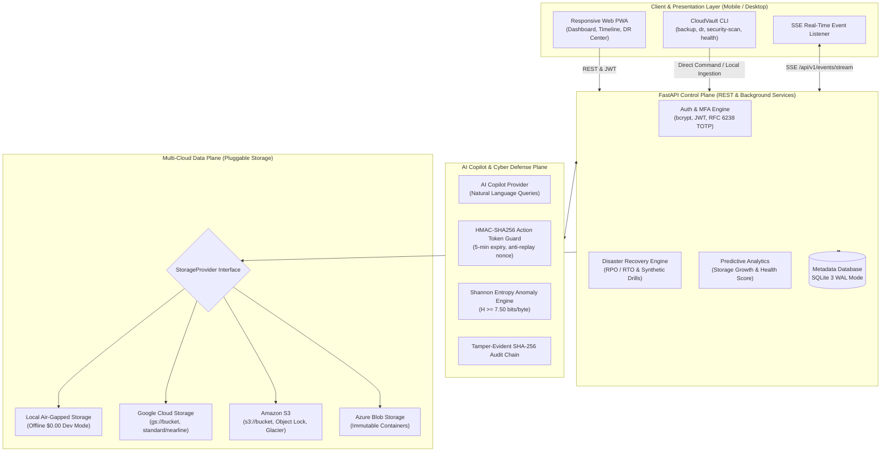
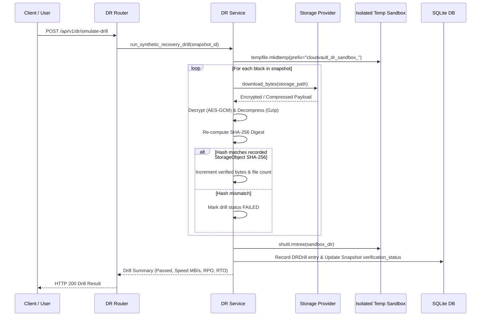

# CloudVault 2.0: System Architecture & Cloud Design
**Project:** CloudVault 2.0 – Intelligent Cloud Backup, Security & Disaster Recovery Platform  
**Cloud Platforms:** Multi-Cloud (Google Cloud Storage, AWS S3, Microsoft Azure Blob Storage, Local Mock)  
**Security Standard:** AES-256-GCM Envelope Encryption, RFC 6238 TOTP MFA, WORM Immutability, HMAC-SHA256 Action Authorization  
**Status:** Approved Technical Architecture  

---

## 1. Architectural Overview & System Decomposition

CloudVault 2.0 decouples its architecture into **five interconnected planes**:
1. **Control Plane:** FastAPI application managing authentication, metadata catalogs, scheduler daemons, and Server-Sent Events (SSE).
2. **AI Copilot & Orchestration Plane:** Natural language engine with deterministic tool dispatching and cryptographic human-in-the-loop authorization.
3. **Cyber Defense Plane:** Shannon entropy anomaly engine and ransomware extension detector with automated WORM snapshot shielding.
4. **Disaster Recovery Plane:** Automated RPO tracking, empirical RTO calculation, and non-destructive synthetic recovery drills.
5. **Data Plane:** Content-Addressed Storage (CAS) with AES-256-GCM envelope encryption and multi-cloud pluggable drivers.



---

## 2. AI Copilot & Cryptographic Authorization Protocol

To resolve the dual imperative of **high automation** and **strict security**, CloudVault 2.0 adopts a **two-tier zero-trust execution model**:

1. **Read-Only Inquiries (Zero Mutation):**
   - Natural language queries regarding protected files, snapshot history, deduplication savings, and system health are resolved dynamically without mutating state.
2. **Controlled Operations (Human-in-the-Loop Confirmation):**
   - When the user asks the assistant to trigger a backup, lock a snapshot, or restore a file, the AI **does not execute the action directly**.
   - Instead, the AI generates a **Proposal Action Card** containing:
     - `proposed_action`: Structured action payload (`TRIGGER_BACKUP`, `RESTORE_FILE`, `LOCK_SNAPSHOT`).
     - `confirmation_token`: A cryptographically signed token generated via:
       $$\text{Signature} = \text{HMAC-SHA256}(K_{\text{secret}}, \text{User ID} \parallel \text{Action} \parallel \text{Expires} \parallel \text{Nonce})$$
     - Tokens expire strictly after **300 seconds (5 minutes)**.
   - The token nonce is tracked in the database (`ai_action_requests`). Upon consumption, `is_executed` is set to `True`, preventing **replay attacks**.
   - Any attempt to use a token across different user accounts is rejected with HTTP 403 Forbidden.
   - All proposals and executions are recorded into a **SHA-256 tamper-evident hash chain**.

---

## 3. Cyber Defense: Shannon Entropy & Ransomware Detection

Ransomware attacks invariably exhibit two macroscopic behaviors:
1. Encrypting existing documents, causing their byte distribution to approach maximum thermodynamic entropy.
2. Appending suspicious file extensions or mass-renaming files.

### Shannon Entropy Formulation
For a byte sequence $X = (x_1, x_2, \dots, x_N)$, the entropy $H(X)$ is computed in bits per byte:
$$H(X) = - \sum_{i=0}^{255} P(b_i) \log_2 P(b_i)$$
where $P(b_i) = \frac{\text{Count}(b_i)}{N}$.

- **Plaintext & Source Code:** $H \in [2.5, 5.0]$ bits/byte.
- **Compiled Binaries:** $H \in [5.5, 6.8]$ bits/byte.
- **AES/ChaCha20 Encrypted Payload:** $H \in [7.5, 8.0]$ bits/byte.

### False-Positive Shielding & Heuristic Scoring
To prevent false alarms on naturally high-entropy formats (`.zip`, `.jpg`, `.mp4`, `.pdf`), CloudVault applies an extension whitelist filter. **High entropy alone never triggers a quarantine event**. An alert requires converging signals:
$$\text{Risk Score} = S_{\text{extension}} (50\,\text{pts}) + S_{\text{entropy\_deviation}} (35\,\text{pts}) + S_{\text{mass\_velocity}} (25\,\text{pts})$$

When $\text{Risk Score} \ge 70$:
1. The alert is logged with `alert_level = "QUARANTINED"`.
2. Existing clean snapshots are automatically placed into **WORM Immutable Lock** for 14 days, preventing the ransomware from corrupting or deleting recovery points.

---

## 4. Disaster Recovery Center Architecture

Disaster recovery readiness is continuously quantified through two core metrics:
1. **Actual Recovery Point Objective (RPO):**
   $$\text{RPO (Hours)} = \frac{T_{\text{now}} - T_{\text{latest verified snapshot}}}{3600}$$
   - $\le 24$ hours: **HEALTHY**
   - $\le 72$ hours: **WARNING**
   - $> 72$ hours: **CRITICAL**
2. **Empirical Recovery Time Objective (RTO):**
   Measured from historical **Synthetic Recovery Drills**:
   $$\text{RTO (Minutes)} = \frac{\text{Total Stored MB}}{\text{Measured Restoration Throughput (MB/s)} \times 60}$$

### Non-Destructive Synthetic Drill Protocol


---

## 5. Security Core & Envelope Encryption

To combine **content-addressed deduplication** with **military-grade confidentiality**, CloudVault 2.0 implements a hybrid envelope encryption architecture:

```
User Master Key Salt + User ID
            |
            v
     PBKDF2-HMAC-SHA256 (100,000 iterations)
            |
            v
   User KEK (Key Encryption Key - 256-bit)
            |
            +------------+
                         |
                         v
     HMAC-SHA256(User KEK, Plaintext SHA-256)
                         |
                         v
          Object DEK (Data Encryption Key - 256-bit)
                         |
                         v
           AES-256-GCM Payload Encryption
            (12-byte Nonce + 16-byte Auth Tag)
```

### Properties of this Scheme:
1. **Intra-User Deduplication:** Identical files uploaded by the *same user* yield the identical deterministic DEK and ciphertext hash, completely preserving storage deduplication.
2. **Zero Cross-User Leakage:** A different user possesses a different KEK; identical plaintext uploaded by User B produces an entirely distinct DEK and ciphertext, eliminating cross-user inference or dictionary attacks.
3. **Tamper Detection:** AES-256-GCM authenticated tags guarantee bit-level detection of any payload tampering at rest.

---

## 6. Multi-Cloud Storage Abstraction

Every storage provider conforms to the abstract `StorageProvider` interface in `backend/app/storage/base.py`:
- `upload_file(local_path, destination_path) -> bool`
- `upload_bytes(data, destination_path) -> bool`
- `download_file(source_path, local_destination_path) -> bool`
- `download_bytes(source_path) -> bytes`
- `delete_file(storage_path) -> bool`
- `file_exists(storage_path) -> bool`
- `get_storage_name() -> str`
- `get_capabilities() -> dict`
- `health_check() -> dict`
- `get_object_metadata(storage_path) -> dict`

The factory `get_storage_provider()` dynamically resolves the active provider based on environment variables or runtime requests. If cloud credentials are missing, the system gracefully falls back to the **Local Air-Gapped Mock Storage Provider**, guaranteeing zero downtime and zero unexpected cloud billing.
