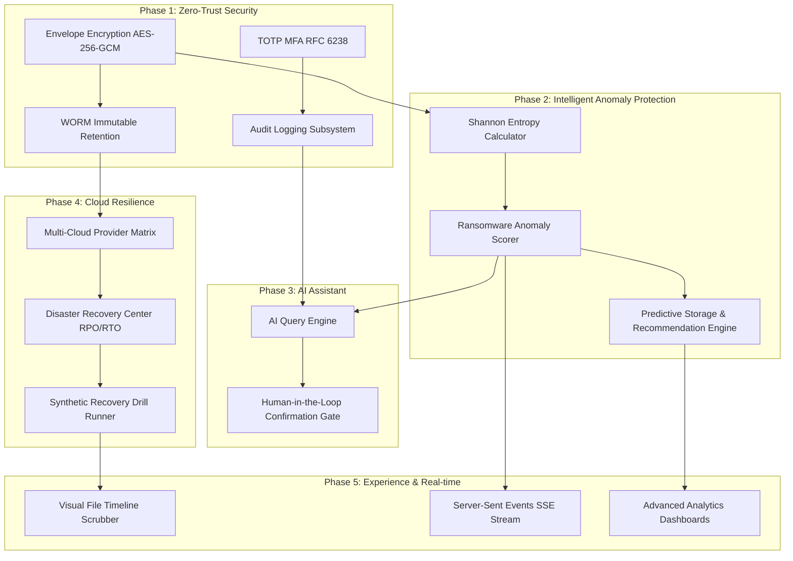

# CloudVault 2.0 – Technical Architecture & Implementation Plan
**Author:** Principal Cloud Architect & Full-Stack Security Engineer  
**Date:** November 2026  
**Status:** Architecture Approved / Ready for Phased Execution  

---

## 1. Executive Summary & Vision

**CloudVault 2.0** evolves the working CloudVault backup and recovery MVP into an **enterprise-grade, AI-powered intelligent cloud resilience platform**. It transforms static backup jobs into an active defense system capable of:
- **Zero-Trust Security:** End-to-end client-side and at-rest envelope encryption (AES-256-GCM) with TOTP-based Multi-Factor Authentication (RFC 6238) and tamper-proof WORM (Write-Once-Read-Many) snapshot retention.
- **Ransomware & Anomaly Defense:** Real-time Shannon entropy analysis, rapid extension monitoring, and anomaly scoring to detect and quarantine malware infections before corrupt backups occur.
- **Conversational AI Assistant:** A scoped, autonomous AI copilot with controlled metadata querying and explicit human-in-the-loop authorization gates for sensitive/destructive operations.
- **Disaster Recovery (DR) Command Center:** Live computation of Recovery Point Objective (RPO) and Recovery Time Objective (RTO), coupled with non-destructive synthetic recovery drills that mathematically verify SHA-256 hash fidelity.
- **Unified Multi-Cloud Fabric:** Extensible storage abstraction supporting Local Mock Storage, Google Cloud Storage (GCS), and adapters for AWS S3 and Azure Blob.
- **Interactive Visual Timeline & Real-Time Events:** Point-in-time file history scrubber and Server-Sent Events (SSE) notification streaming.

---

## 2. Audit of Existing Architecture & Code Quality

### 2.1 Strengths of Current Implementation
- **Clean Layered Architecture:** Clear separation between FastAPI routes (`backend/app/routers`), business domain services (`backend/app/services`), data persistence (`backend/app/models`), and storage adapters (`backend/app/storage`).
- **Content-Addressable Storage (CAS):** File-level deduplication using SHA-256 digests correctly avoids re-uploading identical payloads across files or snapshots.
- **Pluggable Storage Provider:** Clean abstract interface (`StorageProvider`) with both `MockStorageProvider` (local filesystem) and `GCSStorageProvider` (Google Cloud Storage) implementations.
- **Production Hardening:** CORS restrictions, HTTP security headers (`nosniff`, `DENY`), upload size limits (100 MB), path traversal sanitization, and PWA service worker with strict non-caching of API responses.
- **High Test Coverage:** 12 automated unit and integration tests covering auth, backup flows, deduplication, point-in-time recovery, trash recovery, and PWA assets.

### 2.2 Current Limitations & Areas for Evolution
1. **Payload Encryption:** Stored objects are currently compressed (gzip) but unencrypted at the application layer. Storage security relies entirely on provider-level permissions.
2. **Authentication Depth:** Auth is currently single-factor JWT. Critical operations (snapshot deletion, restore to system folders) lack secondary verification.
3. **Auditability:** Backup jobs are logged, but there is no immutable audit trail of user access, failed logins, or policy changes.
4. **Passive Backup Engine:** The scheduler executes statically without inspecting whether scanned files have been encrypted by ransomware (high entropy) or modified en masse.
5. **Recovery Verification:** Recovery integrity is only verified when a user manually restores a file, rather than continuously through automated synthetic drills.

---

## 3. Feature Dependencies & Component Hierarchy



---

## 4. Database Schema Evolution & Non-Destructive Migrations

To maintain **100% backward compatibility** and preserve existing user data in `data/cloudvault.db`, schema modifications will use idempotent `ALTER TABLE ... ADD COLUMN` statements wrapped in a migration utility (`backend/app/migrations.py`).

### 4.1 Modified Existing Tables

#### `users` Table:
- `mfa_secret` (`VARCHAR(64)`, nullable) – Encrypted base32 TOTP secret.
- `mfa_enabled` (`BOOLEAN`, default `False`) – Flags whether TOTP 2FA is required during login.
- `encryption_salt` (`VARCHAR(64)`, nullable) – Per-user cryptographic salt for key derivation (PBKDF2-HMAC-SHA256).

#### `backup_plans` Table:
- `encryption_enabled` (`BOOLEAN`, default `True`) – Controls client-side payload encryption for this plan.
- `immutable_lock_days` (`INTEGER`, default `0`) – Enforced minimum retention lock period.

#### `snapshots` Table:
- `is_immutable` (`BOOLEAN`, default `False`) – WORM protection flag; prevents deletion while locked.
- `lock_until` (`DATETIME`, nullable) – UTC timestamp until which the snapshot cannot be modified or deleted.
- `verification_status` (`VARCHAR(20)`, default `"UNVERIFIED"`) – `"VERIFIED"`, `"FAILED"`, `"UNVERIFIED"`.
- `verified_at` (`DATETIME`, nullable) – Timestamp of latest synthetic recovery drill.

#### `storage_objects` Table:
- `is_encrypted` (`BOOLEAN`, default `False`) – True if payload is AES-256-GCM encrypted.
- `encryption_algo` (`VARCHAR(30)`, default `"AES-256-GCM"`) – Algorithm used.
- `encryption_nonce` (`VARCHAR(64)`, nullable) – 12-byte initialization vector (hex/base64).

### 4.2 New Tables

```sql
-- Security & Operational Audit Log
CREATE TABLE IF NOT EXISTS audit_logs (
    id VARCHAR(36) PRIMARY KEY,
    user_id VARCHAR(36) NOT NULL,
    event_type VARCHAR(50) NOT NULL,       -- AUTH_MFA_ENABLED, BACKUP_COMPLETED, SNAPSHOT_LOCKED, RESTORE_EXECUTED
    severity VARCHAR(20) DEFAULT 'INFO',    -- INFO, WARNING, CRITICAL
    ip_address VARCHAR(45) DEFAULT '',
    user_agent VARCHAR(255) DEFAULT '',
    details TEXT DEFAULT '{}',              -- JSON payload of event metadata
    created_at DATETIME NOT NULL DEFAULT CURRENT_TIMESTAMP,
    FOREIGN KEY(user_id) REFERENCES users(id)
);

-- Ransomware & Anomaly Detections
CREATE TABLE IF NOT EXISTS ransomware_alerts (
    id VARCHAR(36) PRIMARY KEY,
    user_id VARCHAR(36) NOT NULL,
    plan_id VARCHAR(36) NOT NULL,
    risk_score INTEGER NOT NULL,            -- 0 to 100
    alert_level VARCHAR(20) NOT NULL,       -- SUSPICIOUS, HIGH_RISK, QUARANTINED
    suspicious_files_count INTEGER NOT NULL,
    average_entropy FLOAT NOT NULL,         -- Normal < 6.0, Encrypted > 7.5
    matched_extensions TEXT DEFAULT '[]',   -- e.g. [".locked", ".crypto"]
    status VARCHAR(20) DEFAULT 'ACTIVE',    -- ACTIVE, DISMISSED, RESOLVED
    created_at DATETIME NOT NULL DEFAULT CURRENT_TIMESTAMP,
    FOREIGN KEY(user_id) REFERENCES users(id),
    FOREIGN KEY(plan_id) REFERENCES backup_plans(id)
);

-- Disaster Recovery Verification Drills
CREATE TABLE IF NOT EXISTS dr_drills (
    id VARCHAR(36) PRIMARY KEY,
    user_id VARCHAR(36) NOT NULL,
    snapshot_id VARCHAR(36) NOT NULL,
    files_tested INTEGER NOT NULL,
    bytes_tested BIGINT NOT NULL,
    duration_seconds FLOAT NOT NULL,
    restoration_speed_mbps FLOAT NOT NULL,
    rpo_hours FLOAT NOT NULL,
    estimated_rto_minutes FLOAT NOT NULL,
    status VARCHAR(20) NOT NULL,            -- PASSED, FAILED
    error_details TEXT,
    created_at DATETIME NOT NULL DEFAULT CURRENT_TIMESTAMP,
    FOREIGN KEY(user_id) REFERENCES users(id),
    FOREIGN KEY(snapshot_id) REFERENCES snapshots(id)
);

-- MFA Backup Recovery Codes
CREATE TABLE IF NOT EXISTS mfa_recovery_codes (
    id VARCHAR(36) PRIMARY KEY,
    user_id VARCHAR(36) NOT NULL,
    code_hash VARCHAR(255) NOT NULL,
    is_used BOOLEAN DEFAULT 0,
    used_at DATETIME,
    created_at DATETIME NOT NULL DEFAULT CURRENT_TIMESTAMP,
    FOREIGN KEY(user_id) REFERENCES users(id)
);
```

---

## 5. New API Endpoints & Interfaces

### 5.1 Security & Multi-Factor Authentication (`/api/v1/auth`)
- `POST /api/v1/auth/mfa/setup` – Generate TOTP secret and QR code URI.
- `POST /api/v1/auth/mfa/enable` – Validate first 6-digit token and activate MFA; returns 8 one-time backup codes.
- `POST /api/v1/auth/mfa/verify` – Second-step authentication verifying TOTP or backup recovery code.
- `POST /api/v1/auth/mfa/disable` – Disable MFA (requires current password and TOTP code).

### 5.2 Immutable Retention (`/api/v1/backups/snapshots`)
- `POST /api/v1/backups/snapshots/{id}/lock` – Lock snapshot with WORM retention policy until specified date.
- `DELETE /api/v1/backups/snapshots/{id}` – Enforces immutable check; rejects with HTTP 403 if `lock_until > now()`.

### 5.3 Intelligent Protection & Anomaly Detection (`/api/v1/security`)
- `GET /api/v1/security/alerts` – List active ransomware and anomaly alerts.
- `POST /api/v1/security/alerts/{id}/dismiss` – Acknowledge or dismiss an alert.
- `GET /api/v1/security/audit-logs` – Retrieve paginated security and system audit logs.
- `POST /api/v1/security/analyze-path` – Run on-demand Shannon entropy and anomaly scan on a directory.

### 5.4 AI CloudVault Assistant (`/api/v1/ai`)
- `POST /api/v1/ai/query` – Process natural language requests against user backup metadata.
- `POST /api/v1/ai/confirm-action` – Execute a previously staged action token (e.g. restoring files, locking snapshots).

### 5.5 Disaster Recovery & Verification (`/api/v1/dr`)
- `GET /api/v1/dr/metrics` – Get calculated RPO, estimated RTO, and recovery readiness score.
- `POST /api/v1/dr/simulate-drill` – Trigger synthetic recovery drill on latest snapshot with SHA-256 verification.
- `GET /api/v1/dr/history` – History of automated and manual DR drills.

### 5.6 Real-Time Notifications & Visual Timeline (`/api/v1/events` & `/api/v1/recovery`)
- `GET /api/v1/events/stream` – Server-Sent Events (SSE) stream for live job status, ransomware alerts, and audits.
- `GET /api/v1/recovery/timeline/{plan_id}` – File version timeline showing additions, modifications, and deletions across snapshots.

---

## 6. Frontend UI/UX Components

1. **AI Copilot Floating Drawer:**
   - Collapsible natural language chat interface accessible from any screen.
   - Interactive action cards with explicit **[Confirm Execution]** and **[Cancel]** buttons for sensitive operations.
2. **Disaster Recovery Dashboard Tab:**
   - Live RPO gauge (e.g., "RPO: 2.4 hours / Target: < 4 hours - Healthy").
   - Estimated RTO metric (e.g., "RTO: 4.2 minutes for 1.8 GB").
   - One-click **[Run Synthetic DR Drill]** with live execution feedback and SHA-256 verification badges.
3. **Ransomware & Security Center:**
   - Real-time alert pill in the top header.
   - Shannon entropy distribution chart showing clean files vs suspicious high-entropy files.
4. **Visual File Time-Machine (Timeline Scrubber):**
   - Slider control displaying snapshot dates.
   - Visual file diff: Green (+) for created, Yellow (~) for modified, Red (-) for deleted.
5. **MFA Setup Modal:**
   - Clean SVG QR Code display and manual key entry for Google Authenticator / Authy.
   - Display of 8 cryptographic recovery codes with 1-click copy.

---

## 7. Security Risks & Mitigations

| Threat / Risk | Impact | Architectural Mitigation |
| :--- | :--- | :--- |
| **Key Exposure** | Compromise of backup data | User payload keys derived via PBKDF2-HMAC-SHA256 (100,000 iterations) with unique per-user salt. Master encryption key stored only in environment variables; keys never persisted in the database. |
| **AI Prompt Injection** | Unauthorized file deletion or exfiltration | The AI assistant cannot directly mutate data. All modifying actions generate a cryptographically signed HMAC confirmation token requiring human UI approval. |
| **Ransomware False Positives** | Legitimate encrypted archives (e.g., `.zip`, `.gpg`) flagged | Multi-signal scoring engine: high entropy alone flags a warning; quarantine requires extension alteration, entropy spike on previously low-entropy files, and high modification velocity. |
| **Snapshot Tampering / Deletion** | Ransomware deletes backups before encrypting primary data | Snapshots marked with WORM retention locks are physically blocked at the database and storage provider layers from deletion until `lock_until` expiration. |
| **MFA Bypass** | Unauthorized access | TOTP verification uses constant-time comparison (`hmac.compare_digest`) to prevent timing attacks, with rate-limiting on verification attempts. |

---

## 8. Required Libraries & Infrastructure

- **Zero Paid Cloud Infrastructure Required:** Fully operational in Local Mock Storage mode, while retaining immediate 1-click compatibility with live Google Cloud Storage.
- **Python Standard Library & Existing Deps:**
  - `cryptography>=50.0.2` (Already present) – Provides hardware-accelerated AES-256-GCM.
  - Standard `hashlib`, `hmac`, `struct`, `secrets`, `math` – Pure Python RFC 6238 TOTP implementation and Shannon entropy calculations without requiring unstable third-party wheels.
- **Lightweight Frontend:** Pure vanilla ES6+ with SVG chart rendering to preserve fast load times and PWA performance.

---

## 9. Comprehensive Testing Strategy

1. **Unit Tests:**
   - AES-256-GCM encryption/decryption round-trip with corrupted payload detection.
   - RFC 6238 TOTP code generation, verification, time window tolerance, and recovery code consumption.
   - Shannon entropy calculator on known plain text vs high-entropy cipher text.
   - Anomaly scoring algorithm against simulated ransomware attack scenarios.
2. **Integration Tests:**
   - End-to-end encrypted backup, CAS deduplication of encrypted blocks, and verified decryption.
   - Snapshot immutable lock enforcement: attempting to delete a locked snapshot returns HTTP 403.
   - Synthetic DR drill simulation: verifies that damaged payloads fail drill tests and healthy ones pass.
   - AI Assistant query parser and confirmation-token execution workflow.
3. **Regression Tests:**
   - Full regression suite of all 12 existing tests to ensure zero breaking changes to existing CloudVault capabilities.

---

## 10. Phased Implementation Roadmap

```
+---------------------------------------------------------------------------------------+
| Phase 1: Security Core (AES-256-GCM, TOTP MFA, WORM Retention, Audit Logging)         |
| Complexity: Medium-High | Duration: Immediate Priority                                |
+---------------------------------------------------------------------------------------+
                                           |
                                           v
+---------------------------------------------------------------------------------------+
| Phase 2: Intelligent Anomaly & Ransomware Protection (Entropy, Signatures, Scoring)  |
| Complexity: Medium | Focus: Proactive Detection & Backup Shielding                    |
+---------------------------------------------------------------------------------------+
                                           |
                                           v
+---------------------------------------------------------------------------------------+
| Phase 3: Conversational AI Assistant (Natural Language Query, Scoped Tool Execution)   |
| Complexity: High | Focus: Safe Copilot with Human-in-the-Loop Confirmation            |
+---------------------------------------------------------------------------------------+
                                           |
                                           v
+---------------------------------------------------------------------------------------+
| Phase 4: Cloud Resilience & Disaster Recovery Center (RPO/RTO Engine, DR Drills)      |
| Complexity: Medium-High | Focus: Measurable Business Continuity & Multi-Cloud         |
+---------------------------------------------------------------------------------------+
                                           |
                                           v
+---------------------------------------------------------------------------------------+
| Phase 5: Visual Timeline, Real-Time SSE Notifications & Advanced Analytics             |
| Complexity: Medium | Focus: User Experience, Mobile Polish, Responsive Analytics      |
+---------------------------------------------------------------------------------------+
```

