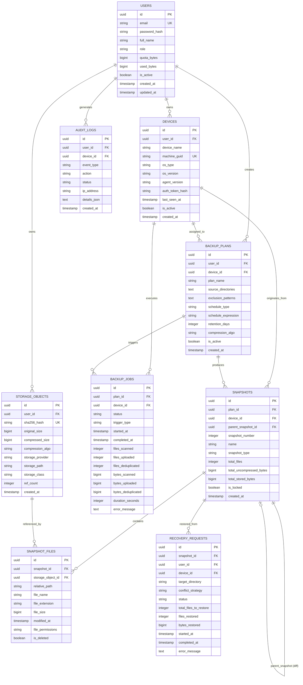

# CloudVault: Database Schema & Entity-Relationship Design
**Project:** CloudVault – Cloud-Based Backup and Recovery System  
**Subject:** Cloud Computing Technology (4–6 Week University Project)  
**Database Engines:** SQLite (Local Dev / Offline) & PostgreSQL (Production / Cloud SQL)  
**Author / Architect:** Senior Software Architect & Technical PM  
**Status:** Approved Baseline  
**Date:** November 2026  

---

## 1. Database Architecture & Design Principles

The CloudVault metadata database manages user accounts, client devices, scheduled backup policies, point-in-time snapshot hierarchies, deduplicated storage objects, and execution logs.

### Core Database Principles:
1. **File-Level Deduplication via SHA-256:** The `storage_objects` table stores unique binary files indexed by their `sha256_hash`. Multiple snapshots referencing identical files point to the same `storage_object_id`.
2. **Reference Counting for Safe Purging:** Every `storage_object` maintains a `ref_count`. When a snapshot is purged, reference counts decrement. A physical file is only deleted from cloud/mock storage when `ref_count == 0`.
3. **Immutable Snapshot Trees:** Snapshot records and their `snapshot_files` rows are immutable once committed, ensuring reliable point-in-time recovery.
4. **Dialect Agnostic (SQLAlchemy):** Runs seamlessly on SQLite (for zero-setup local dev on an 8–16 GB laptop) and PostgreSQL (for production/cloud deployment).

---

## 2. Entity-Relationship Diagram (ERD)



---

## 3. Detailed Table Specifications

### 3.1 `users`
Tracks user credentials, storage quota, and access status.

| Column | Type | Constraints | Description |
|---|---|---|---|
| `id` | VARCHAR(36) | PRIMARY KEY | UUID string identifier. |
| `email` | VARCHAR(255) | UNIQUE, NOT NULL | User login email. |
| `password_hash` | VARCHAR(255) | NOT NULL | `bcrypt` / `Argon2id` hashed password. |
| `full_name` | VARCHAR(100) | NOT NULL | User display name. |
| `role` | VARCHAR(20) | NOT NULL, DEFAULT 'user' | Access level (`admin`, `user`). |
| `quota_bytes` | BIGINT | NOT NULL, DEFAULT 5368709120 | Storage quota limit (default 5 GB). |
| `used_bytes` | BIGINT | NOT NULL, DEFAULT 0 | Current total bytes stored in cloud/mock. |
| `is_active` | BOOLEAN | NOT NULL, DEFAULT TRUE | Account active flag. |
| `created_at` | TIMESTAMP | NOT NULL, DEFAULT NOW() | Account creation timestamp. |
| `updated_at` | TIMESTAMP | NOT NULL, DEFAULT NOW() | Last update timestamp. |

### 3.2 `devices`
Tracks client endpoints running the CloudVault Agent.

| Column | Type | Constraints | Description |
|---|---|---|---|
| `id` | VARCHAR(36) | PRIMARY KEY | UUID string identifier. |
| `user_id` | VARCHAR(36) | FOREIGN KEY (users.id) | Owning user. |
| `device_name` | VARCHAR(100) | NOT NULL | Device name (e.g., "Student-Laptop"). |
| `machine_guid` | VARCHAR(128) | UNIQUE, NOT NULL | Hardware / OS unique identifier. |
| `os_type` | VARCHAR(30) | NOT NULL | `Windows`, `Linux`, `Darwin`. |
| `os_version` | VARCHAR(50) | NOT NULL | OS build version. |
| `agent_version` | VARCHAR(20) | NOT NULL | Client software version. |
| `auth_token_hash` | VARCHAR(255) | NOT NULL | Hashed machine authentication token. |
| `last_seen_at` | TIMESTAMP | NULL | Heartbeat timestamp. |
| `is_active` | BOOLEAN | NOT NULL, DEFAULT TRUE | Device active flag. |
| `created_at` | TIMESTAMP | NOT NULL, DEFAULT NOW() | Registration timestamp. |

### 3.3 `backup_plans`
Defines source folders, schedules, and retention policies.

| Column | Type | Constraints | Description |
|---|---|---|---|
| `id` | VARCHAR(36) | PRIMARY KEY | UUID string identifier. |
| `user_id` | VARCHAR(36) | FOREIGN KEY (users.id) | Policy owner. |
| `device_id` | VARCHAR(36) | FOREIGN KEY (devices.id) | Bound client machine. |
| `plan_name` | VARCHAR(100) | NOT NULL | Policy name (e.g., "Project Work & Docs"). |
| `source_directories`| TEXT (JSON) | NOT NULL | Monitored directory paths (JSON array). |
| `exclusion_patterns`| TEXT (JSON) | NOT NULL | Exclusion globs (JSON array, e.g. `*.tmp`). |
| `schedule_type` | VARCHAR(20) | NOT NULL | `cron`, `interval`, `watcher`, `manual`. |
| `schedule_expression`| VARCHAR(100) | NOT NULL | Cron string or interval in seconds. |
| `retention_days` | INTEGER | NOT NULL, DEFAULT 30 | Snapshot retention before pruning. |
| `compression_algo` | VARCHAR(20) | NOT NULL, DEFAULT 'gzip' | `gzip` or `zstd`. |
| `is_active` | BOOLEAN | NOT NULL, DEFAULT TRUE | Active schedule toggle. |
| `created_at` | TIMESTAMP | NOT NULL, DEFAULT NOW() | Policy creation timestamp. |

### 3.4 `storage_objects` (Deduplication Core)
Represents physical binary objects stored in GCS or Local Mock Storage.

| Column | Type | Constraints | Description |
|---|---|---|---|
| `id` | VARCHAR(36) | PRIMARY KEY | UUID string identifier. |
| `user_id` | VARCHAR(36) | FOREIGN KEY (users.id) | Object owner. |
| `sha256_hash` | VARCHAR(64) | UNIQUE, NOT NULL | SHA-256 checksum of the original file. |
| `original_size` | BIGINT | NOT NULL | Uncompressed byte count. |
| `compressed_size` | BIGINT | NOT NULL | Stored byte count after compression. |
| `compression_algo` | VARCHAR(20) | NOT NULL | Compression format applied. |
| `storage_provider` | VARCHAR(20) | NOT NULL | `mock` or `gcs`. |
| `storage_path` | VARCHAR(255) | NOT NULL | Key path (`objects/{sha256}`). |
| `storage_class` | VARCHAR(20) | NOT NULL, DEFAULT 'STANDARD' | `STANDARD`, `NEARLINE`, etc. |
| `ref_count` | INTEGER | NOT NULL, DEFAULT 1 | Active snapshot reference count. |
| `created_at` | TIMESTAMP | NOT NULL, DEFAULT NOW() | Ingestion timestamp. |

### 3.5 `snapshots`
Represents an immutable point-in-time backup state.

| Column | Type | Constraints | Description |
|---|---|---|---|
| `id` | VARCHAR(36) | PRIMARY KEY | UUID string identifier. |
| `plan_id` | VARCHAR(36) | FOREIGN KEY (backup_plans.id) | Originating backup policy. |
| `device_id` | VARCHAR(36) | FOREIGN KEY (devices.id) | Originating machine. |
| `parent_snapshot_id`| VARCHAR(36)| FOREIGN KEY (snapshots.id), NULL | Pointer to previous snapshot for diffs. |
| `snapshot_number` | INTEGER | NOT NULL | Sequential snapshot index per plan. |
| `name` | VARCHAR(150) | NOT NULL | Friendly snapshot label with timestamp. |
| `snapshot_type` | VARCHAR(20) | NOT NULL | `full`, `incremental`. |
| `total_files` | INTEGER | NOT NULL | Total files captured in snapshot. |
| `total_uncompressed_bytes`| BIGINT | NOT NULL | Logical size of all files in snapshot. |
| `total_stored_bytes` | BIGINT | NOT NULL | Newly stored physical bytes for this run. |
| `is_locked` | BOOLEAN | NOT NULL, DEFAULT FALSE | Lock against accidental deletion. |
| `created_at` | TIMESTAMP | NOT NULL, DEFAULT NOW() | Snapshot creation timestamp. |

### 3.6 `snapshot_files`
Virtual filesystem mapping: links a snapshot path to a deduplicated `storage_object`.

| Column | Type | Constraints | Description |
|---|---|---|---|
| `id` | VARCHAR(36) | PRIMARY KEY | UUID string identifier. |
| `snapshot_id` | VARCHAR(36) | FOREIGN KEY (snapshots.id) ON DELETE CASCADE | Associated snapshot. |
| `storage_object_id`| VARCHAR(36)| FOREIGN KEY (storage_objects.id) | Binary content reference. |
| `relative_path` | VARCHAR(1000)| NOT NULL | Path relative to monitored root. |
| `file_name` | VARCHAR(255) | NOT NULL | File base name. |
| `file_extension` | VARCHAR(50) | NULL | File extension (`.pdf`, `.py`). |
| `file_size` | BIGINT | NOT NULL | Original file size in bytes. |
| `modified_at` | TIMESTAMP | NOT NULL | Local file modified timestamp. |
| `file_permissions` | VARCHAR(20) | NULL | File permissions / attributes. |
| `is_deleted` | BOOLEAN | NOT NULL, DEFAULT FALSE | Marker for files deleted in this snapshot. |

### 3.7 `backup_jobs` & `recovery_requests` & `audit_logs`
- **`backup_jobs`:** Tracks every backup run with metrics: `status` (`RUNNING`, `SUCCESS`, `FAILED`), `trigger_type` (`SCHEDULED`, `MANUAL`, `WATCHER`), `files_scanned`, `files_uploaded`, `files_deduplicated`, `bytes_uploaded`, `bytes_deduplicated`, `duration_seconds`, and `error_message`.
- **`recovery_requests`:** Tracks restore tasks: `target_directory`, `conflict_strategy` (`overwrite`, `rename`, `skip`), progress, and status.
- **`audit_logs`:** Tamper-evident log recording events: `LOGIN`, `BACKUP_START`, `BACKUP_COMPLETE`, `RESTORE_FILE`, `PURGE_SNAPSHOT`.

---

## 4. Query Indexing Strategy

```sql
-- Fast deduplication query (Executed on every file candidate)
CREATE INDEX idx_storage_objects_hash ON storage_objects (user_id, sha256_hash);

-- Fast snapshot virtual file tree navigation
CREATE INDEX idx_snapshot_files_lookup ON snapshot_files (snapshot_id, relative_path);

-- Fast point-in-time diff queries
CREATE INDEX idx_snapshots_plan_created ON snapshots (plan_id, created_at DESC);

-- Fast backup job history queries
CREATE INDEX idx_backup_jobs_plan_date ON backup_jobs (plan_id, started_at DESC);
```

---

## 5. Garbage Collection & Reference Counting Logic

When a snapshot expires according to its retention policy:
1. Query all `storage_object_id`s referenced in `snapshot_files` for that snapshot.
2. For each unique storage object:
   - Decrement `ref_count = ref_count - 1`.
   - If `ref_count == 0`:
     - Delete the physical file from storage provider (GCS or Local Mock).
     - Delete the `storage_objects` database record.
     - Deduct `compressed_size` from `users.used_bytes`.
3. Delete the `snapshots` record (which cascades and deletes its `snapshot_files`).
4. Record the deletion in `audit_logs`.
